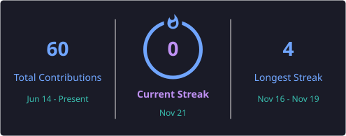

# Ha Trung Kien

**Information Security & Security Engineering OJT candidate** · Ho Chi Minh City, Vietnam

I'm an Information Security student at **FPT University (2025–2028, expected graduation)** and a **full-tuition scholarship recipient for the entire degree program**. My academic work connects static PE malware analysis, ML threat detection and secure Python/Flask backend engineering.

  
  

**OJT focus:** Information Security · Security Engineering · Threat & Malware Analysis
**Contact:** [hatrungkien2657@gmail.com](mailto:hatrungkien2657@gmail.com)

## Core Arsenal

**Security & Forensics**

  
  
  
  

**Code & ML**

  
  
  
  
  

**Web / Database**

  
  
  
  
  

## Featured Security Case Studies

| Project | My contribution & verified scope | Explore |
| --- | --- | --- |
| **CNN Byteplot & Entropy for Malware Classification** · IAM302t | **Team Lead.** Evaluation tooling for 5 experiment groups (E1–E5), analysis of 182 disarmed PE audit records, and review of a cross-packer pilot across 10 shared test parents, 4 configurations and 3 seeds. Research scope and limitations are documented. | [Case study](https://kin-jong-un2657.github.io/case-studies/iam302t.html) · [Repository — private](https://github.com/Kin-jong-un2657/IAM302t-Group6-Byteplot) |
| **Spam, Phishing & BEC Email Detection** · AIC211 | **Team Lead.** Three-class academic baseline using TF-IDF and email metadata; compares Naive Bayes, Linear SVM and XGBoost. **Evaluation corrections and metric re-evaluation are pending.** | [Case study](https://kin-jong-un2657.github.io/case-studies/aic211.html) · [Repository](https://github.com/Kin-jong-un2657/AIC211-Spam-BEC-Email-Detection) |
| **MiniEcommerce Secure Web & Database System** · PWD301 | **Database & Product Developer.** Flask/SQL Server implementation with 3 database integrity rules, 4 discovery capabilities and 14 authored pytest test functions for review/stock regressions. | [Case study](https://kin-jong-un2657.github.io/case-studies/miniecommerce.html) · [Team repository](https://github.com/ChauLeGiaBao/MiniEcommerce-PWD301) |

IAM302t source access requires authorization; its case study is public. Audit records are not independent-parent counts, and authored test functions are not a claim of newly passing test cases.

## GitHub Activity

  
  

Public GitHub activity, refreshed daily. Technical decisions, evaluation status and contribution details are available in the case studies.
